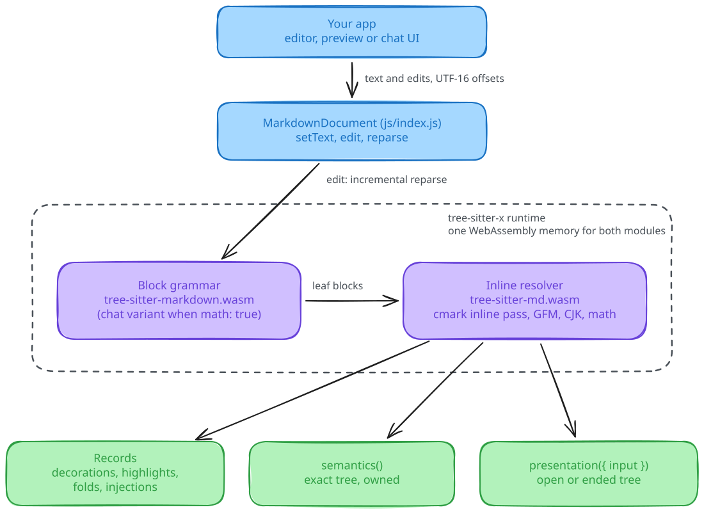

# How tree-sitter-md works

tree-sitter-md splits Markdown parsing in two. A tree-sitter grammar finds the blocks. A C resolver, loaded into the same tree-sitter runtime, reads the text inside each block. This page explains why the split exists and what each side keeps between edits. For the file-level layout, see [Development](../development.md).

<picture>
  <source media="(prefers-color-scheme: dark)" srcset="../assets/architecture.dark.svg">
  
</picture>

*An edit reparses blocks incrementally. Only the leaf blocks you read get inline resolution.*

## Why two parts

A Markdown document has two kinds of structure with different edit behavior. Block structure (headings, lists, quotes, fences, tables) depends on line starts and indentation, and tree-sitter's incremental parser handles that well. Inline structure (emphasis, links, code spans) depends on delimiter matching inside one paragraph, and one typed `*` can change everything after it in that paragraph. Document-wide reference definitions can change a link far away.

The [upstream tree-sitter-markdown](https://github.com/tree-sitter-grammars/tree-sitter-markdown) tokenizes every word so that GLR can recognize reference definitions. That turned each paragraph into a chain of fragile nodes that an incremental reparse could not reuse. tree-sitter-md tokenizes one line at a time, treats the text of a leaf block as one `inline` node, and leaves inline structure to cmark's inline pass. See [ADR 001](../adr/001-block-grammar-one-token-per-line.md) and [ADR 002](../adr/002-c-inline-resolver-from-cmark.md).

## Parts

| Part | Where | Job |
| --- | --- | --- |
| Block grammar | `grammar/`, built as `tree-sitter-markdown.wasm` | Block structure. One token per line. The scanner validates leading reference definitions with cmark. |
| CHAT grammar | `grammar/chat/`, built as `tree-sitter-markdown-chat.wasm` | The same grammar plus `$$` flow math. Selected by `math: true`. See [ADR 004](../adr/004-chat-profile-as-a-separate-grammar.md). |
| Resolver | `src/` and `vendor/cmark/`, built as `tree-sitter-md.wasm` | Leaf mapping, cmark's inline pass, GFM autolinks, definitions, footnotes, records, highlights, folds, injections, semantic and presentation extraction. |
| Binding | `js/` | `MarkdownDocument`. Writes UTF-16 text into shared memory and copies results out. |

The resolver is a tree-sitter-x extension. It imports tree-sitter's C API from the host and walks the host's trees directly, so the tree never crosses a module boundary. See [ADR 003](../adr/003-resolver-as-a-tree-sitter-x-extension.md).

## What an edit costs

1. The binding writes the inserted text into shared memory and calls `tsmd_edit`.
2. tree-sitter reparses the block tree incrementally. The scanner state is serialized, so unchanged subtrees are reused.
3. Reference definitions are rescanned only in the changed ranges. When a definition changes, the cached leaves that looked up that label are dropped.
4. The next read resolves inline constructs for the leaves it touches. Each leaf's result is cached under a hash of its text and continuation layout. A keystroke in one paragraph therefore resolves one paragraph.

Nothing in the typing path is whole-document. Whole-document reads (`semantics()`, `presentation()`) are separate calls and cost time proportional to the document. See [Performance](../reference/performance.md).

A leaf is the unit of reuse. A very large single paragraph, table or code block is one leaf, so an edit inside it pays for the whole leaf on the next read.

## Why records and snapshots

Editors ask for small answers about a few rows, many times per second. `decorations`, `highlights`, `folds` and `injections` return flat `Uint32Array` records for a range and nothing else. Renderers ask for the whole document once. `semantics()` returns a complete owned tree with decoded text. Both come from the same parse.

`presentation({ input })` serves chat renderers. With `input: 'open'`, the resolver treats the end of the text as provisional, so an unclosed `**` renders as bold and an unclosed `[label` becomes a pending link. With `input: 'ended'`, it returns the exact tree. See the [chat guide](../guides/stream-a-chat-reply.md).

## Source text is kept as received

The binding keeps the original UTF-16 text separate from the normalized text the parser sees. NUL, BOM, CRLF and lone surrogates survive in `source` and in node ranges. See [Source fidelity](../reference/source-fidelity.md).

## Related

- [Supported syntax](../reference/syntax.md)
- [Compatibility and limits](../reference/compatibility.md)
- [Source provenance](../reference/provenance.md)
